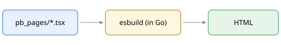

<% slot('title', () => { %>Markdown<% }) %>

# Markdown pages

This page is `docs/index.md`. Markdown pages run through EJS first, so <%= 'this text' %> came from an EJS tag,
then through goldmark (CommonMark + GFM).

## Images go through asset()



The image above is a relative path; the rendered `src` is fingerprinted and served with an immutable cache header.

## Tables and code

| File | URL |
|---|---|
| `index.ejs` | `/` |
| `docs/index.md` | `/docs` |
| `notes/[id].ejs` | `/notes/abc123` |

```js
// notes/+page.ts
export function load(ctx) {
  return { notes: ctx.pb().collection('notes').getFullList({ sort: '-created' }) }
}
```

- [x] Front matter (`title: <%= meta('title') %>`)
- [x] Heading ids: [jump to tables](#tables-and-code)
